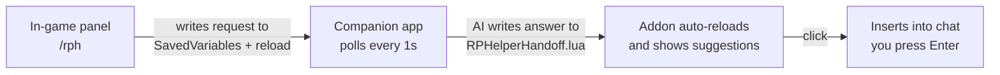

# RPHelper

A roleplay response co-pilot for World of Warcraft — for you and your friends on your new RPPVP server.

**How it works** (two pieces, because WoW addons can't call AI APIs themselves):



1. **WoW addon** (`Addon/`) — the whole GUI lives in-game: describe the scene, pick a tone, hit *Write suggestions*. The addon persists a request into its SavedVariables and reloads the UI (WoW writes SavedVariables on reload).
2. **Companion app** (Node, zero dependencies, runs in background) — polls the SavedVariables file every second, calls the AI (OpenRouter, default `deepseek/deepseek-v4-flash`), writes the answer into `RPHelperHandoff.lua`. The addon auto-reloads once more and shows the suggestions. Click one to drop it into chat; **you** press Enter (nothing is ever sent automatically).

The browser page (`http://127.0.0.1:7331`) is now just a **settings/status page**: model, paths, and the character sheet (personality & speech quirks) that feeds the AI.

## Quick start

```powershell
# 1. Start the companion app
npm start
# → opens http://127.0.0.1:7331

# 2. Install the addon into WoW
npm run install:addon

# 3. In WoW: /rph to toggle the panel
```

> 💡 The character sheet (name, race, class, spec) auto-fills from the game — the addon saves it into its SavedVariables, so type `/reload` once after your first login with the addon. Or click **🎮 Pull from game** anytime. Without the addon data, name + realm are still detected from the WTF folder.

### Workflow per scene (no alt-tab)

1. In WoW: `/rph` → describe the scene → pick a tone → **Write suggestions**
2. The UI reloads twice automatically (request → AI → answer), ~3–5 s total
3. Click a suggestion → it lands in your chat box → press **Enter**

Slash shortcuts: `/rph set <scene>` (describe + generate in one command), `/rph tone <name>`, `/rph reload`.

## Configuration

Copy `config.example.json` → `config.json`:

| Key | Meaning |
|---|---|
| `port` | Companion app port (default `7331`) |
| `savedVariablesPath` | Leave empty for auto-detect; or set the full path to `RPHelperHandoff.lua` inside your WoW `AddOns\RPHelper` folder |
| `wowRoot` | Optional: your WoW `_retail_` folder, if auto-detection can't find it (used for character auto-fill) |
| `openrouter.apiKey` | Your OpenRouter key (https://openrouter.ai) — optional, offline templates work without it |
| `openrouter.model` | Any chat model, default `deepseek/deepseek-v4-flash` |

> ⚠️ `config.json` is gitignored — it holds your API key. The server binds to `127.0.0.1` only, so it's never reachable from the network.

## Project layout

```
RPHelper/
├── server/server.js     # Zero-dep Node server: AI + handoff writer + static host
├── public/              # Companion web UI (vanilla HTML/CSS/JS)
├── Addon/               # WoW addon (Lua) — install to Interface\AddOns
├── scripts/             # install-addon.ps1
├── config.example.json  # copy to config.json
└── README.md
```

## RP tips for newcomers

- **Less is more** — 1–3 sentences per reply beats a wall of emote text.
- **Never write for the other player** — you control your character only.
- **`/reload` is your friend** — the handoff file is read at load time.
- **Consent matters** — if someone doesn't seem into the scene, ease off.
- Keep it fun; nobody's grading you. Everyone was new once.
