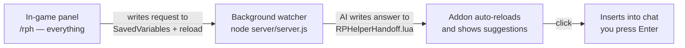

# RPHelper

A roleplay response co-pilot for World of Warcraft — for you and your friends on your new RPPVP server.

**How it works** (two pieces, because WoW addons can't call AI APIs themselves):



1. **WoW addon** (`Addon/`) — the entire GUI: character sheet (personality & speech quirks), scene description, tone, count, suggestions. Describe the scene, hit *Write suggestions*. The addon persists a request into its SavedVariables and reloads the UI (WoW writes SavedVariables on reload).
2. **Background watcher** (Node, zero dependencies, no web UI) — polls the SavedVariables file every second, calls the AI (OpenRouter, default `deepseek/deepseek-v4-flash`), writes the answer into `RPHelperHandoff.lua`. The addon auto-reloads once more and shows the suggestions. Click one to drop it into chat; **you** press Enter (nothing is ever sent automatically).

**No browser needed** — keep the watcher terminal open while playing.

## Quick start (friends: one-time setup, then forget it)

```powershell
# 1. Build the standalone watcher (no Node needed to run it)
npm run build:exe

# 2. Install the addon into WoW
npm run install:addon

# 3. Register the watcher to start with Windows (invisible, minimized)
npm run install:autostart

# 4. In WoW: /rph to open the panel
```

After that, friends never type anything: `RPHelper.exe` starts with Windows, the addon GUI does the rest. Dev alternative: `npm start` runs the watcher from source.

> 💡 Name, race, class, spec & level are captured automatically by the addon (SavedVariables). Personality and speech quirks are edited right in the panel — everything stays in-game. A blank status page lives at `http://127.0.0.1:7331` (health only, no GUI).

### Workflow per scene (no alt-tab)

1. In WoW: `/rph` → describe the scene → pick a tone → **Write suggestions**
2. The UI reloads twice automatically (request → AI → answer), ~3–5 s total
3. Click a suggestion → it lands in your chat box → press **Enter**

Slash shortcuts: `/rph set <scene>` (describe + generate in one command), `/rph tone <name>`, `/rph reload`.

## Configuration

Copy `config.example.json` → `config.json`:

| Key | Meaning |
|---|---|
| `savedVariablesPath` | Leave empty for auto-detect; or set the full path to `RPHelperHandoff.lua` inside your WoW `AddOns\RPHelper` folder |
| `wowRoot` | Optional: your WoW client folder (`_forever_`), if auto-detection can't find it |
| `openrouter.apiKey` | Your OpenRouter key (https://openrouter.ai) — optional, offline templates work without it |
| `openrouter.model` | Any chat model, default `deepseek/deepseek-v4-flash` |

> ⚠️ `config.json` is gitignored — it holds your API key. The watcher opens no ports and makes no network connections except to OpenRouter.

## Project layout

```
RPHelper/
├── server/server.js     # Watcher: polls requests, calls AI, writes answers, status page
├── server/player.js     # SavedVariables / WTF discovery helpers
├── Addon/               # WoW addon (Lua) — the whole GUI lives here
├── public/              # Blank status page (health only, no GUI)
├── scripts/             # install-addon.ps1, build-exe.mjs, install-autostart.ps1
├── config.example.json  # copy to config.json
└── README.md
```

## RP tips for newcomers

- **Less is more** — 1–3 sentences per reply beats a wall of emote text.
- **Never write for the other player** — you control your character only.
- **`/reload` is your friend** — the handoff file is read at load time.
- **Consent matters** — if someone doesn't seem into the scene, ease off.
- Keep it fun; nobody's grading you. Everyone was new once.
