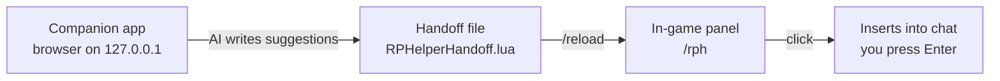

# RPHelper

A roleplay response co-pilot for World of Warcraft — for you and your friends on your new RPPVP server.

**How it works** (two pieces, because WoW addons can't call AI APIs themselves):



1. **Companion app** (Node, zero dependencies) — a local web page where you fill in your character sheet and the scene, hit *Generate*, and get 3 in-character reply suggestions. Uses OpenRouter if you add an API key; falls back to offline templates if not.
2. **WoW addon** (`Addon/`) — a draggable in-game panel that shows the suggestions. Click one to drop it into your chat box; **you** press Enter (nothing is ever sent automatically).

## Quick start

```powershell
# 1. Start the companion app
npm start
# → opens http://127.0.0.1:7331

# 2. Install the addon into WoW
npm run install:addon

# 3. In WoW: /rph to toggle the panel
```

### Workflow per scene

1. Fill in the scene in the browser → **Generate suggestions**
2. Edit them if you like → **Send to game**
3. In WoW type `/reload`, then `/rph`
4. Click a suggestion → it lands in your chat box → press **Enter**

## Configuration

Copy `config.example.json` → `config.json`:

| Key | Meaning |
|---|---|
| `port` | Companion app port (default `7331`) |
| `savedVariablesPath` | Leave empty for auto-detect; or set the full path to `RPHelperHandoff.lua` inside your WoW `AddOns\RPHelper` folder |
| `openrouter.apiKey` | Your OpenRouter key (https://openrouter.ai) — optional, offline templates work without it |
| `openrouter.model` | Any chat model, default `openai/gpt-4o-mini` |

> ⚠️ `config.json` is gitignored — it holds your API key. The server binds to `127.0.0.1` only, so it's never reachable from the network.

## Project layout

```
RPHelper/
├── server/server.js     # Zero-dep Node server: AI + handoff writer + static host
├── public/              # Companion web UI (vanilla HTML/CSS/JS)
├── Addon/               # WoW addon (Lua) — install to Interface\AddOns
├── scripts/             # install-addon.ps1
├── config.example.json  # copy to config.json
└── README.md
```

## RP tips for newcomers

- **Less is more** — 1–3 sentences per reply beats a wall of emote text.
- **Never write for the other player** — you control your character only.
- **`/reload` is your friend** — the handoff file is read at load time.
- **Consent matters** — if someone doesn't seem into the scene, ease off.
- Keep it fun; nobody's grading you. Everyone was new once.
